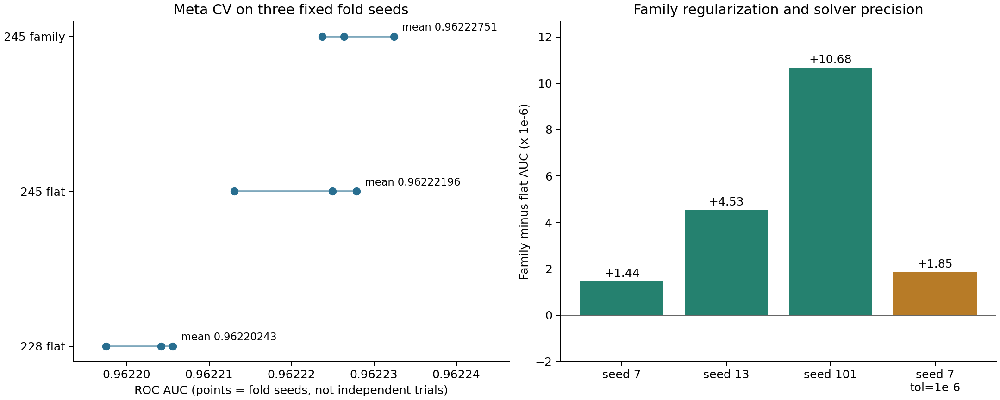

> 本仓库只提供方法 3 的独立实现，见 [README](../README.md)。本文保留完整研究历史；其中其他方案、旧版脚本和 CSV 仅作为历史记录提及，不包含在仓库中。当前入口是 [family_stack.py](../family_stack.py)、[prepare_inputs.py](../prepare_inputs.py) 和 [run.sh](../run.sh)，原文历史运行命令不适用于此独立目录。

# 航空旅客满意度预测工作报告

**最终方法：基于 245 个公开 OOF 预测的家族正则化 Stacking（第三轮方法 3）**

最新结果确认：2026-11-13，private ROC-AUC **0.96238**，排名 **106/373**（用户反馈）。原报告日期：2026-10-13。提交文件：`submission_v3_family.csv`。用户实际提交的公开榜 ROC-AUC：**0.96186**；固定 seed=7 的五折元模型 CV AUC：**0.96222639**。

本项目完成数据审计、关联分析、原始字段特征工程实验、公开预测整理、元模型训练及验证。最终方法采用公开基模型的预测作为输入，在本地训练家族正则化逻辑回归。245 个基模型没有在本项目中重新训练；家族正则方案来自 [Twin Stacks 博客](https://www.kaggle.com/code/goodpjw2008/s6e10-twin-stacks-family-reg-lb-0-96187)。报告中的本地原始特征工程实验有独立的模型和消融记录，作为方法研究过程呈现。

## 1. 最终方法选择与五个提交的关系

第三轮编号沿用交付时的顺序，以下公开榜分数均来自用户反馈。

| 编号 | 提交文件 | 实际计算方法 | 元 CV AUC，seed=7 | 公开榜 AUC |
|---|---|---|---:|---:|
| 1 | `submission_v3_twin_published.csv` | 作者固定 245-stack 文件与 Dariush 固定 247-stack 文件，各占 1/2 的排名平均 | 未提供匹配的独立 CV | **0.96187** |
| 2 | `submission_v3_twin_family.csv` | 本项目方法 3 与 Dariush 文件，各占 1/2 的排名平均 | 未提供匹配的独立 CV | **0.96187** |
| **3** | `submission_v3_family.csv` | **245 列预测变换 + 家族缩放 + L2 逻辑回归** | **0.96222639** | **0.96186** |
| 4 | `submission_v3_twin.csv` | 本项目方法 5 与 Dariush 文件，各占 1/2 的排名平均 | 未提供匹配的独立 CV | **0.96187** |
| 5 | `submission_v3_245.csv` | 245 列预测变换 + 统一 L2 逻辑回归 | 0.96222494 | **0.96186** |

### 1.1 方法 1 是什么程度的复现

**方法 1 是博客最终预测融合步骤的精确复现。** 读取作者发布的两个固定父文件，对各自的测试预测取平均名次，再按 1:1 融合：

\[
r_i(v)=\frac{\operatorname{rank}_{\mathrm{average}}(v_i)}{n},
\qquad q_i=\tfrac12 r_i(v^{245})+\tfrac12 r_i(v^{247}).
\]

相同分数取平均名次，测试集大小 n=299,844。融合结果属于排序分数，不能直接解释为校准后的满意概率。

本项目执行了下载、按 id 对齐、重新计算和核对；没有为方法 1 重训两个父模型。生成文件与作者发布的最终 CSV 数值最大差为 **0**，SHA-256 也完全一致：

~~~text
76ae202cc32fa7c8990218c3a5db68bba942120a86f0337eb649028c6fa4ee3a
~~~

证据：`reference_verification.json`。因此，方法 1 适合作为复现基准，不能将其 0.96187 描述为本项目独立设计特征和训练全部模型的结果。

### 1.2 为什么选择方法 3 写工作报告

方法 3 有完整且紧密的研究链条：**公开预测形成二级特征 → 概率转对数几率 → 按模型家族调整正则强度 → 多划分验证 → 全量拟合并保存模型 → 生成提交**。每一步都有对应代码、输入、对照实验和可重载产物。

与方法 5 相比，方法 3 能具体讨论“相关成员数量不均时，统一正则是否合适”，三种元验证划分和较严格求解精度的检查均给出同向的小幅改善。二者公开榜都为 0.96186，因此选择方法 3 的依据是方法结构与局部验证证据，不能声称家族正则已经在公开榜显著胜出。

方法 2 在方法 3 后增加公开测试预测的排名融合，公开榜高 0.00001，可保留为竞赛提交方案。方法 3 的训练和验证过程更适合承担报告主线。它的核心特征工程是**预测表示与家族缩放**。若单独评价业务原始字段的构造逻辑，第 4 节的本地“航程画像 + teacher + 目标编码”实验更直接，但该实验没有进入第三轮方法 3。

## 2. 任务、数据与实际数据处理

任务是根据旅客资料、出行信息和服务评分预测满意程度，标签 satisfaction 为二分类。采用 ROC-AUC 评价排序能力：随机选取一位满意旅客和一位不满意旅客，前者预测值更高的概率，平分情况计 1/2。提交保留连续分数，没有按 0.5 转换成硬标签。

### 2.1 数据概况

| 项目 | 审计结果 |
|---|---|
| 训练集 | 699,635 行 |
| 测试集 | 299,844 行 |
| 原始预测字段 | 21 列，不含 id 和标签 |
| 类别字段，4 列 | Gender、Customer Type、Type of Travel、Class |
| 数值字段，4 列 | Age、Flight Distance、Departure Delay in Minutes、Arrival Delay in Minutes |
| 服务评分，13 列 | Wi-Fi、时间便利性、在线订票、登机口位置、餐饮、在线登机、座椅、娱乐、机上服务、腿部空间、行李、值机、清洁度 |
| 满意标签 | 310,339 行，占 44.3573% |
| 相同 21 维特征的训练重复或冲突标签组 | 0 |
| 测试与训练的完整特征向量匹配 | 0 |

统计来自 [audit.json](../metadata/data_audit.json)。完整字段名称和数据约束见 `data_utils.py`。

### 2.2 具体做了哪些清洗或预处理

原始文件保持不变。执行的是数据契约检查和针对模型的编码；没有大规模删行、异常值截尾或人工修正标签。

| 对象 | 实际操作 | 适用阶段及原因 |
|---|---|---|
| 训练/测试结构 | 检查字段一致性、id 唯一性、两集合 id 不重叠、sample_submission 行序 | 所有实验，保证标签和预测对齐 |
| 标签 | False/True 转换为 0/1，存为整数 | 所有监督学习实验 |
| 缺失值 | 到达延误有训练 292 条、测试 130 条缺失，占 0.0417%/0.0434%；其余字段无缺失 | 保留全部竞赛样本，树模型原生处理 NaN |
| 线性原始基线 | 在拟合分区学习数值中位数插补、缺失指示、数值标准化与类别独热编码 | 仅第一轮原始字段 Logistic 基线；不属于最终元模型预处理 |
| 评分 0 | 原值保留，不替换成缺失；第一轮另测试零值指示特征 | 0 的满意率与 1 分明显不同 |
| 异常值与合法范围 | 检查评分属于 0～5、连续量非负且无无穷值；不截尾、不删除极端延误或航程 | 不凭经验抹去可能有用的尾部信息 |
| 重复记录 | 检查完全重复和冲突标签，实际未发现需要删除的竞赛记录 | 没有执行竞赛数据去重删行 |
| id | 只用于行对齐、提交与审计，不作为预测特征 | 避免把顺序标识当业务信息 |
| 类别平衡 | 保持原分布，无过采样、欠采样或类别权重 | 正例占 44.36%，未采用失衡修正 |
| 外部原始调查 | 仅在 teacher 支线中排除与竞赛完整特征匹配的 21 条外部记录 | 详见第 4.3 节；没有删除竞赛训练/测试记录 |
| 公开预测 | 检查版本哈希、长度、有限值、概率范围及行序；排除没有完整 OOF/test 对的文件 | 最终方法输入准备 |
| 概率边界 | 概率截到 [10⁻¹⁵, 1−10⁻¹⁵]，转换 logit 后截到 [−30, 30] | 最终方法的数值稳定处理；不是对原始业务字段做异常值清洗 |

最终元模型接收的是有限的公开预测矩阵，没有对该矩阵插补缺失值，也没有使用 StandardScaler。公开基模型在各自训练中使用的全部清洗细节并非本项目执行步骤；能核实的来源与成员说明保存在公开快照和成员表中。

## 3. 关联性与重要性如何指导实验

原始字段关联统计只使用第一轮 559,708 条开发样本。相关性用于提出候选特征，不直接证明因果关系或最终集成中的独立贡献。

| 观察 | 数值证据 | 对特征与模型的启示 |
|---|---|---|
| 在线登机信号强 | 与标签互信息 0.346859 bit，Spearman 0.602846 | 保留原字段，比较与 Wi-Fi、出行类型的交互 |
| Wi-Fi 关系非单调 | 评分 0/2/5 的满意率为 88.67%/27.01%/95.05%；互信息 0.176066 bit，Spearman 仅 0.287220 | 不将 0 视为最低质量，不统一施加单调约束 |
| 舱位需要结合场景解释 | 商务舱中，商务/个人出行满意率为 73.27%/11.49% | 比较 Class × Type of Travel 等交叉特征 |
| 数字服务指标相关 | Wi-Fi 与在线订票 Spearman 0.770525 | 汇总可能降噪，但仍保留原字段 |
| 舒适度指标相关 | 座椅与清洁度 0.733252；娱乐与清洁度 0.727072 | 比较分组均值、最小值及评分差值 |
| 两种延误不能互相替代 | 出发与到达延误 Spearman 0.469447 | 比较延误差、追回延误及准点标志 |

第一轮冻结模型后，还对 12,000 条分层抽取的留出样本进行了 3 次重复置换。出行目的、Wi-Fi、客户类型的平均 AUC 降幅分别为 **0.066656、0.053718、0.029022**；联合置换客户类型、出行目的和舱位时为 **0.149665**。每次从原始字段置换并重新构造派生特征，避免派生列保留被置换信息。

置换结果描述第一轮模型的条件依赖；它不能作为第三轮 245 列元模型对原始字段的重要性，也不能将不同单列降幅相加作为组贡献。第一轮留出集在后续研究中已成为已知数据，第三轮没有继续把它当作全新独立测试集。

来源：[数据发现](DATA_FINDINGS.md)、`置换重要性明细`、`置换实现`。

## 4. 原始字段特征工程：本地实际完成的探索

本节回答项目实际构造过哪些业务特征、为何构造、效果如何。这条支线最终输出 `submission_v2_local.csv`，与第 5 节的最终 245 列方案分别保存。其特征和模型没有被直接加入第三轮方法 3。

### 4.1 第一轮：服务、延误和交互

`features.py` 中实现并测试了以下候选：

| 变体 | 构造方法 | 总维数 |
|---|---|---:|
| 原始字段 | 4 类别 + 13 评分 + 4 数值 | 21 |
| 服务汇总 | 总体均值/最小/最大/标准差、0 分/低分/高分/满分数量、非零均值；数字、舒适、人员、便利服务各自均值/最小值；13 个零值标记；3 对评分差及相等标记 | 57 |
| 延误特征 | 到达−出发、追回延误、总延误、最大延误、准点与到达超 15/60 分钟标志、到达缺失标记、延误及航程 log1p、每千单位航程延误 | 34 |
| 类别交互 | 舱位×出行目的等 8 个交叉项，年龄和航程分箱 | 31 |
| 全部组合 | 合并上述新增列 | 80 |

在相同 LightGBM 31 叶设置下，初筛 AUC：原始 **0.95815217**，延误 **0.95808504**，服务 **0.95804365**，交互 **0.95790596**，全部 **0.95769654**。这说明直觉合理的汇总不一定带来增益，树本身已经能学习不少交互。该阶段保留原始字段强基线，没有把更多列作为默认改进。

首轮共完成 15 组初筛、开发集三折比较和冻结后的留出验证。原始 Logistic 初筛 AUC 为 0.94873022，原始 LightGBM 127 叶为 0.95857753；最终采用 LightGBM、XGBoost、CatBoost 等权融合，独立留出 AUC **0.95838429**，用户公开榜 **0.95821**。初筛、开发 CV、留出和公开榜各自有不同用途，不能混成一个排行榜。完整结果见 [第一轮实验报告](RESULTS.md)。

### 4.2 第二轮：将航程当作分组线索

精确航程值在训练中有 3,474 种，训练与测试合并后 3,521 种；最常见的 20 个值覆盖合并数据的 13.59%。因此将 Flight Distance 作为代理分组键，研究同航程旅客的构成。相同距离不保证相同真实航线，报告中的“航程画像”仅指这种统计分组。

使用训练和测试的**无标签字段**构造：

1. 按精确 Flight Distance 分组，对其余 20 个字段求均值，增加 20 列。4 个类别字段先按统一类别字典编码，均值是类别构成的粗略代理，不具有天然的大小语义。
2. 增加该航程出现次数 route_count，1 列。
3. 分别统计 Age、Flight Distance、Departure Delay、Arrival Delay 各取值的出现次数，4 列。

总维度从 **21 → 46**。航程计数与 Flight Distance 频数表达相同统计量，当前实际实现保留了两列，没有将它们宣称为两个独立信息源。

这些统计使用测试字段分布，属于利用无标签测试集的传导式特征工程；没有使用测试标签。另有 22 维对照实验，在原始 21 列上加一个航程类别副本，用来比较树直方图分箱是否丢失离散航程结构。该副本没有叠加到 46 维画像方案中。

### 4.3 原始调查 teacher

原始调查来自 [Airline Passenger Satisfaction 数据集](https://www.kaggle.com/datasets/teejmahal20/airline-passenger-satisfaction)。合并外部 train/test 后共有 129,880 行。

只保留相同 21 个预测字段和满意标签，将外部 satisfied 映射为 1；统一数值类型后，对完整特征向量做哈希匹配，排除与竞赛记录重合的 21 条外部记录，其中竞赛训练对应 17 条、测试对应 4 条。teacher 使用剩余 **129,859** 条外部记录训练。

teacher 为 XGBoost：600 轮、学习率 0.05、深度 8、subsample=0.8、colsample_bytree=0.5、CUDA hist、random_state=0，支持类别字段。将其对竞赛行的预测加入航程画像，维度 **46 → 47**。该列把外部调查中学到的标签关系压缩为一个预测特征。teacher 本身对竞赛训练数据的 AUC 为 0.95492918，作用在于提供补充信息。

### 4.4 折内平滑目标编码

在 47 列上加入 6 个目标编码，维度 **47 → 53**：

- Flight Distance；
- Age；
- Flight Distance × Age；
- Flight Distance × Class；
- Flight Distance × Type of Travel；
- Age × Class × Type of Travel × Customer Type。

每个分组 g 的编码为：

\[
\operatorname{TE}(g)=\frac{\sum_{i\in g}y_i+20\mu}{n_g+20},
\]

其中 \(\mu\) 为当前可用训练分区的正例率。训练行用内部 5 折 KFold 交叉拟合编码，随机种子 20261012，使该行标签不参与自己的编码；外部验证/测试行使用完整拟合分区建立的映射。未见组合回退到该分区正例率。没有用全体训练标签先编码再切分验证集。

### 4.5 消融与本地模型选择

第二轮使用 559,708 行开发数据及 139,927 行外部验证数据，切分种子 20261012。开发集内部再分 447,766 行拟合与 111,942 行调参，种子 20261013；先在内层确定轮数，再用完整开发集按固定轮数训练并评价外层。外层没有参与早停和目标编码统计拟合，但用于比较这 9 个方案，因此是开发验证，不是最终独立测试。

| 方案 | 维度 | 选定轮数 | 外部开发验证 AUC |
|---|---:|---:|---:|
| XGBoost，首轮风格参数、128 bins | 21 | 410 | 0.95892299 |
| XGBoost，第二轮原始基线、256 bins | 21 | 1,322 | 0.95909732 |
| XGBoost，4,096 bins | 21 | 1,595 | 0.95980847 |
| XGBoost，增加航程类别副本 | 22 | 1,509 | 0.96023594 |
| XGBoost，航程画像 | 46 | 1,214 | 0.96068185 |
| XGBoost，画像 + teacher | 47 | 642 | 0.96119496 |
| XGBoost，画像 + teacher + 目标编码 | 53 | 603 | 0.96136478 |
| **LightGBM，画像 + teacher + 目标编码** | **53** | **645** | **0.96139341** |
| CatBoost，相同 53 列 | 53 | 1,093 | 0.96126238 |

同一 XGBoost 基线上，航程画像增加 **0.00158452**，teacher 再增加 **0.00051312**，目标编码再增加 **0.00016981**。目标编码增益的条件配对 95% 区间为 [−0.00000559, 0.00034522]，证据弱于前两项，不能只看点估计。

本地支线选择 LightGBM：学习率 0.02、127 叶、min_child_samples=50、subsample=0.8、subsample_freq=1、colsample_bytree=0.5、reg_lambda=1、max_bin=255，固定 645 轮。最终分层五折训练，每折重新构造目标编码，测试概率取五折平均，描述性 OOF AUC 为 **0.96106870**。该单独文件没有用户回传的 Kaggle 分数。

将这个本地模型的 OOF/test 加入原 228 列后，元 CV 从同求解设置对照 **0.96220560** 降至 **0.96220120**，5 折均未改善；第二轮实际公开榜也仍是 0.96183。因此最终第三轮没有加入它。好的单模型特征工程不一定为已有大集成提供新的有效信息。

实现与证据：`route_v2.py`、`数据审计`、`消融结果`、`配对差异`、`支线最终产物`。

## 5. 最终方法的特征工程：245 列预测表示

### 5.1 整体流程

OOF 指基模型对其未用于拟合的训练行输出的预测。公开成员提供 OOF/test 成对文件，使元模型能学习“如何组合不同模型的判断”。

~~~mermaid
flowchart TD
    A["竞赛训练标签与 id"] --> V["检查文件、行序和成员顺序"]
    B["公开 OOF：699635 × 245"] --> V
    C["公开测试预测：299844 × 245"] --> V
    V --> D["241 列概率转 logit 4 列原始分数保留"]
    D --> E["按家族缩放：1、1、3、1.5"]
    E --> F["3 个种子的五折元 CV 统一 L2 与家族 L2 对照"]
    F --> G["固定 C=0.003 全量训练一个逻辑回归"]
    E --> H["相同列序与缩放处理测试矩阵"]
    G --> I["sigmoid 输出连续预测"]
    H --> I
    I --> J["submission_v3_family.csv"]
~~~

最终矩阵的每列代表一个公开成员的预测，**不是一个原始业务字段**。21 个原始字段不再直接拼入元模型。第 4 节的本地 53 列矩阵也不在此流程中。

### 5.2 来源与成员池扩展

| 阶段 | 加入的来源标签及数量 | 累计列数 |
|---|---|---:|
| 初始池 | core 124、tfm 11、golem 3、torres 38、forge 6 | 182 |
| 补充池 | abdullah 5、koumei 7、sachith 2、kratosyan 2、kagankoral 5、yekenot 1、hermengardo 1、allcat 1、amanatar 5 | 211 |
| 第二轮扩展 | goodpjw2008 extra 17 | 228 |
| 第三轮扩展 | kagankoral ablation 17 | **245** |

来源标签不是模型家族；逐列文件、排列顺序、表示方式、OOF AUC、家族及缩放见 [members.json](../metadata/members.json) 和 `members.csv`。公开源地址与固定版本见 `第二轮来源表`、`第三轮来源表`。

新增 17 列来自 [kagankoral 的 ablation-members，version 1](https://www.kaggle.com/datasets/kagankoral/s6e10-ablation-members-oof)，其中 14 个树模型成员、3 个 RealMLP 成员。作者成员元数据明确列出：

| 成员类别 | 作者记录的上游特征/训练差异 |
|---|---|
| raw，3 个树模型 | 原始 21 列 |
| enc3，3 个树模型 | 原始列 + 原始调查预测/目标编码 + 频数 + 竞赛目标编码 |
| enc4，3 个树模型 | enc3 + 成对目标编码 |
| enc4 10-fold，3 个树模型 | 上述特征，10 折及较低学习率 |
| allcat，2 个 CatBoost | 原始字段增加类别副本，目标编码与正则配置不同 |
| RealMLP，3 个 | 数值字段的类别副本、不同种子/编码增强 |

以上是作者公开元数据所述，来源为 `新增成员说明`。本项目复用这些训练结果，未在本地逐一重建它们的上游特征。因此报告中能逐行追溯的本地特征构造，是下述预测变换和家族缩放。

### 5.3 成对校验与行对齐

先校验下载快照 SHA-256，确保来源版本不漂移；OOF 与测试数组长度分别须为 699,635 和 299,844，且为有限值。成员名不得重复。

有 id 的文件要求 id 唯一、集合完全匹配，并按当前训练/测试 id 重排；有单独 id 文件的来源核对该文件。没有 id 的 NPY 使用作者声明的原始行序。新增 17 列还要求本地计算 OOF AUC 与作者公布值相差小于 0.000002。该检查可以发现明显错位，但不能代替带 id 的逐行身份验证。

原公开池中，两个只有原始调查 teacher 输出、没有完整竞赛 OOF/test 对的文件被排除。保留的成员均有可用的成对预测。旧 228 列有 121 对 logit 相关系数大于 0.999，但没有 OOF 和测试同时完全相同的成员对；没有按相关阈值机械删列，因为删列会改变正则在相关成员间的分配。

### 5.4 统一预测表示

对于 241 列概率预测 \(p_{ij}\)，执行：

$$
\tilde p_{ij}=\min(1-10^{-15},\max(10^{-15},p_{ij})),
\qquad z_{ij}=\operatorname{clip}\left(\log\frac{\tilde p_{ij}}{1-\tilde p_{ij}},-30,30\right).
$$

logit 将概率变为有正负方向的证据分数，便于线性元模型学习各成员的贡献。边界截断避免 0/1 造成无穷值。所有矩阵存为 float64。

其余 4 列输入已有超出 [0,1] 的原始分数，沿用原值：ar_cat_5f、ar_lgb_5f、ar_realmlp_5f、ar_xgb_5f。代码的表示分类称为 logit，但这里不假设这四个公开原始分数一定是严格的概率对数几率，也不再次转换或标准化。

### 5.5 家族缩放就是分组正则

沿用博客的名称分组规则：包含 tabpfn 或以 pfn_ 开头归入 TabPFN；以 tfm_ 开头或包含 tabicl/tabm 归入 TFM/TabM；包含 realmlp/rmlp/mlp 归入 MLP；其余归入 GBDT。这是复现用的正则分组，尤其 TabM 被放在 TFM 组内，不代表严格的模型分类学。

| 正则分组 | 列数 | 输入缩放 \(s_j\) | 对原始空间系数的相对 L2 惩罚 \(1/s_j^2\) |
|---|---:|---:|---:|
| GBDT | 157 | 1 | 1 |
| MLP | 58 | 1 | 1 |
| TabPFN | 16 | 3 | 1/9 |
| TFM/TabM | 14 | 1.5 | 1/2.25 |

元模型输入为 \(x_{ij}=s_j z_{ij}\)。逻辑回归拟合：

\[
\hat p_i=\sigma\left(b+\sum_{j=1}^{245}w_j s_j z_{ij}\right),
\]

\[
\min_{b,w}\ \sum_i \operatorname{BCE}(y_i,\hat p_i)
  +\frac{1}{2C}\sum_j w_j^2,\qquad C=0.003.
\]

若用原始预测空间的系数 \(\beta_j=s_jw_j\) 表示，同一惩罚为：

\[
\frac{1}{2C}\sum_j\frac{\beta_j^2}{s_j^2}.
\]

因此放大某一组输入，会减轻该组在原始空间中的收缩。它为成员数较少、可能提供互补判断的家族设置了不同的正则先验，最终系数仍由标签学习。缩放 3 和 1.5 **不是固定融合权重**，没有强制 TabPFN 必须占三倍贡献，也没有按家族列数归一化。

尺度来自博客方案，本轮按固定设置验证，没有在本地重新搜索整张尺度网格。高相关列之间的系数可相互补偿，不能只凭系数绝对值判断模型或原始业务字段的重要性。缩放空间与原始空间系数分别保存在 `coefficients_family.csv`。

## 6. 模型选择与验证证据

### 6.1 为什么使用 L2 逻辑回归组合

基模型已提供非线性预测，元模型的任务是学习互补与冗余关系。大量高度相关的预测容易产生不稳定权重，L2 为权重提供收缩；逻辑回归训练二元交叉熵，使用 AUC 比较配置。这里没有直接优化 AUC，也没有把所有成员视为同等质量。

第二轮公开池最佳单成员 OOF AUC 为 **0.96174405**；228 列直接平均概率为 **0.96161246**，平均 logit 为 **0.96166122**，均未超过该单成员。学习组合权重有明确的实验动机。最终层实际比较的是不同成员池与 L2 方案，没有开展非线性元模型的全面竞赛，也不声称逻辑回归是所有可能模型中的全局最优。

第二轮五折元 CV 的主要结果：

| 配置 | 元 CV AUC | 用户公开榜 AUC |
|---|---:|---:|
| 182 列，C=0.003 | 0.96211096 | 无对应反馈 |
| 211 列，C=0.003 | 0.96218157 | 无对应反馈 |
| 228 列，C=0.001 | 0.96219299 | 0.96180 |
| **228 列，C=0.003** | **0.96220484** | **0.96183** |
| 228 列，C=0.01 | 0.96219011 | 0.96183 |

由此沿用 C=0.003。第三轮没有重新调 C，而是在相同设置下分开验证“新增 17 列”和“家族正则”两项改变。

### 6.2 固定三种划分的元模型 CV

使用 StratifiedKFold，5 折、shuffle=True，随机种子依次为 7、13、101。每个验证折只用于评估该折的元模型；元模型训练使用另外四折已有的基模型 OOF。将五折验证分数拼回原始行序，再计算一次整体 ROC-AUC，表中数值不是五个 AUC 的简单平均。

| 划分种子 | 228 列统一 L2 | 245 列统一 L2 | **245 列家族 L2** | 新增 17 列增益 | 家族正则增益 |
|---|---:|---:|---:|---:|---:|
| 7 | 0.96220560 | 0.96222494 | **0.96222639** | +0.00001934 | +0.00000144 |
| 13 | 0.96220418 | 0.96222790 | **0.96223243** | +0.00002372 | +0.00000453 |
| 101 | 0.96219750 | 0.96221303 | **0.96222371** | +0.00001553 | +0.00001068 |

seed=7 的 228 列对照使用与本轮相同的单 BLAS 线程求解设置，其 0.96220560 与第二轮初始执行的 0.96220484 相差 0.00000076。对照使用同设置结果，避免把有限求解精度差异算成特征收益。

新增 17 列在三个种子下均为 5/5 折改善，条件配对 95% 区间均大于 0。家族正则的增益较小，三个种子分别为 4/5、2/5、5/5 折改善；对应区间：

| 种子 | 家族 L2 − 统一 L2 的条件配对 95% 区间 |
|---|---|
| 7 | [−0.00000732, +0.00001021] |
| 13 | [−0.00000442, +0.00001348] |
| 101 | [+0.00000169, +0.00001967] |

默认 tol=0.0001。额外以 seed=7、tol=0.000001 检查求解精度：统一 L2 为 **0.96222413**，家族 L2 为 **0.96222599**，差 **+0.00000185**，条件区间 [−0.00000451, +0.00000822]。最终全量模型仍使用预定默认 tol=0.0001。

这些结果支持保留家族方案作为工作报告主方法，但家族改善的证据弱于新增成员。三个划分使用同一份数据，不能当作三个独立试验合并显著性；配对区间只描述固定预测下的样本抽样差异，不包含基模型重训及历史选模的不确定性。

数据来源：`comparison.csv`、`paired_comparisons.json`、`固定协议`。

### 6.3 验证范围

上述结果是**固定公开 OOF 上的元模型交叉验证**。本项目没有在每个元验证折内重新训练全部基模型，公开成员的折划分、早停和历史特征选择可能存在依赖。因此它不等价于整个系统从原始数据开始的严格嵌套验证。

公开榜 0.96186 来自 Kaggle 测试标签对提交的评价，是另一项实测证据。方法 1、2、4 的 0.96187 与其相差 0.00001；这种显示精度下的差距不能证明私有榜顺序。2026-11-13 用户确认方法 3 的 private AUC 为 **0.96238**、排名 **106/373**。

## 7. 全量训练、推理与提交

完成对照后，在全部 **699,635 × 245** 家族缩放矩阵上拟合一个最终逻辑回归：

| 参数/处理 | 实际设置 |
|---|---|
| estimator | sklearn.linear_model.LogisticRegression |
| penalty / C | L2 / 0.003 |
| solver | lbfgs |
| tol / max_iter | 0.0001 / 5,000 |
| fit_intercept | True，截距不受 L2 惩罚 |
| class_weight | None |
| 数值与线程 | float64；每次拟合 1 个 BLAS 线程 |
| 停止检查 | ConvergenceWarning 视为错误 |
| 全量实际迭代数 | 122 |

最终文件由这个**全量拟合元模型**生成，没有平均五个元 CV 模型。测试端按同一成员顺序读取 299,844 × 245 矩阵，应用相同 logit 与家族缩放，再计算 sigmoid(decision_function)。

保存文件 [model_family.joblib](../model/model_family.joblib) 包括模型、245 个成员名、缩放向量和协议哈希。以下代码说明已有矩阵上的实际拟合/推理关系，运行应放在 Compute Node：

~~~python
# Z_train、Z_test 已按 members 顺序完成概率/logit 变换
scale = np.array([m["scale"] for m in members])
model = LogisticRegression(
    C=0.003, solver="lbfgs", tol=1e-4, max_iter=5000
).fit(Z_train * scale, y)
prediction = expit(model.decision_function(Z_test * scale))
~~~

正式实现还保存和重载模型，验证重载预测最大绝对差为 **0**；CSV 写入再读回的最大误差为 **1.11×10⁻¹⁶**。提交仅含 id 和 satisfaction，299,844 行，保持 sample_submission 顺序；分数范围为 **[0.00446055, 0.99794864]**。这些是连续模型输出，没有额外调阈值或做事后校准。

## 8. 代码、复现入口与产物追溯

| 文件 | 在流程中的作用 |
|---|---|
| `data_utils.py` | 原始数据读取、标签转换、数据契约、哈希和 Compute Node 检查 |
| `features.py`、`experiment.py` | 第一轮业务特征与模型消融 |
| `route_v2.py` | 本地航程画像、外部 teacher、折内目标编码及模型比较 |
| `download_public.py` | 第二轮公开预测和外部调查快照 |
| `prepare_public_v2.py` | 228 列公开预测的对齐、表示变换和成员记录 |
| `download_public_v3.py` | 新增公开文件的固定版本下载与哈希验证 |
| `stack_v3.py` | prepare：245 列组装；family：分组；cv：元验证；main：全量训练、保存与提交 |
| `finish_v3.py` | 提交/父文件核验、读取成绩登记、生成第三轮报告和归档 |
| `run_v3.sh` | Slurm 作业入口 |
| `submission_registry.json` | 实际成绩与提交、模型、源码 SHA-256 的绑定 |

沿用项目已有 Python 3.9.19 虚拟环境、scikit-learn 1.6.1 以及 `requirements.lock`。完整训练入口已包含对源码、数据与矩阵哈希的检查。当前项目已有第二轮 prepared 矩阵和同执行设置的 228 列对照，第三轮使用它们作为前置产物。

~~~bash
# 当前已有第二轮输入准备产物时：
.venv/bin/python -u download_public_v3.py
sbatch run_v3.sh
# 上一作业成功结束后，再核验与生成第三轮归档：
sbatch --cpus-per-task=2 --mem=6G --time=00:15:00 run_v3.sh finish
~~~

如果从缺少第二轮产物的工作副本开始，需要先按 [README](../README.md) 完成第二轮公开数据准备和 stack/finish 流程，不能仅下载新增 17 列就运行第三轮。重跑会覆盖同名输出；历史提交对应的准确文件以登记哈希为准，已有保存模型及源代码快照用于追溯。

第三轮训练作业 **41390** 已完成，申请 MGPU-TC2 / normal、4 CPU、20 GB、无 GPU；脚本统计训练、比较及输出总耗时 **26.30 分钟**。报告归档验证作业为 **41407**。本次工作报告依据已保存产物与新反馈编写，没有重新训练模型或修改已提交预测。

关键文件指纹：

| 文件 | SHA-256 |
|---|---|
| submission_v3_family.csv | f1b704c31df2946eb2986419882ad43c4088952e58df36b480e8607ce23917d9 |
| artifacts_v3/model_family.joblib | 0201c4c4f2eb928480e9e544bdb50d08e208b7000731659b6fba61320b719758 |
| artifacts_v3/source_snapshot/stack_v3.py | 8b316d4e1e1605a872714400d0b7250f3eb14ddc3f5ab7d863944cc7fabb76ba |

完整历史成绩见 `SUBMISSION_HISTORY.md`。已有 submissions_v3.zip 保留提交前归档快照；2026-10-13 的用户回传分数以项目成绩登记及本报告为准。

## 9. 可据实写入报告的结论

本项目在原始字段分析基础上完成服务汇总、延误和交互特征对照，确认这些简单派生没有稳定改善首轮树模型；进一步以航程分组统计、外部调查 teacher 和折内目标编码将本地开发验证 AUC 提升到 0.96139341。该本地模型加入公开集成后未带来增益，最终没有纳入第三轮。

最终采用公开 OOF 作为二级特征，经过概率 logit 变换与家族缩放，用 L2 逻辑回归学习组合。新增 17 个公开成员在三种元验证划分中均改善 5/5 折；家族正则提供更小、同向但不够稳定的附加增益。方法 3 的 seed=7 元 CV AUC 为 **0.96222639**，用户公开榜为 **0.96186**，相对第一轮实际公开榜 0.95821 提升 **0.00365**。

报告中的工作贡献是数据分析、候选特征实现与消融、公开产物整合和检查、组合器训练及验证，而非发明家族正则算法或从头训练全部公开基模型。第一轮原始建模、本地 53 特征支线和最终公开 OOF 元模型各有对应结果，读者可据此复现并判断每项改动的作用。

主要参考资料及项目快照：

- [Secrets to Satisfaction? It's Stacking](https://www.kaggle.com/code/yeashusemwal/secrets-to-satisfaction-it-s-stacking)：多家族 OOF 组合思路；`项目保存的 Notebook`。
- [228-member Meta-Stack](https://www.kaggle.com/code/goodpjw2008/s6e10-228-member-meta-stack-lb-0-96184)：成员池、正则组合和无效尝试记录；`项目保存的 Notebook`。
- [Twin Stacks + Family Regularization](https://www.kaggle.com/code/goodpjw2008/s6e10-twin-stacks-family-reg-lb-0-96187)：245 成员、家族缩放与等权排名融合；本项目研究快照为版本 8，`Notebook`。
- [Route-ID FE + Original Model Stack](https://www.kaggle.com/code/goodpjw2008/s6e10-route-id-fe-og-model-stack-lb-0-96108)：航程分组与原始调查模型的参考思路；`项目保存的源码`。
- [Dariush Afshar 的 247-member Stack](https://www.kaggle.com/code/dariushafshar/s6e10-247-public-oofs-one-stack-lb-0-96187)：方法 1、2、4 的一个固定公开父文件来源，未进入方法 3。
