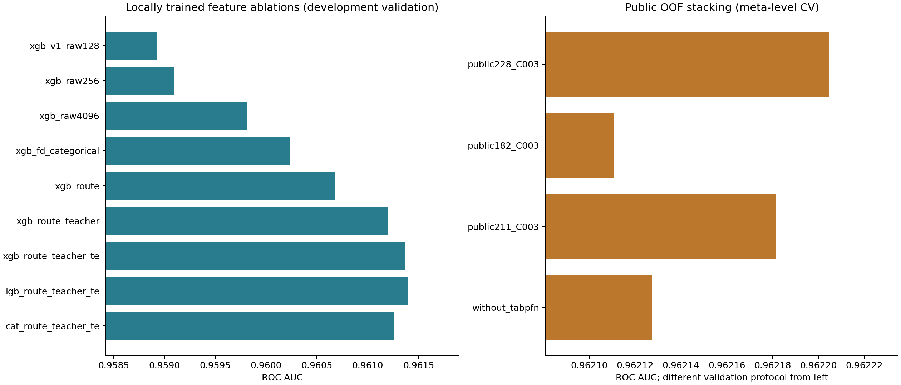

> 历史研究文档，保留原实验范围和当时结果。独立仓库仅包含方法 3 的代码；历史版本代码、CSV 与提交说明不随仓库提供。当前使用方式见 [README](../README.md)。

# 第二轮实验：航程特征与公开 OOF stacking

## 交付与选择

推荐提交 **`submission_v2.csv`**，299,844 行，概率连续值。第一轮提交由用户确认公开榜 **0.95821**。第二轮用户实测：主方案、加入本地成员、C=0.01 均为 **0.96183**；C=0.001 为 **0.96180**。文件、代码与哈希的对应关系见 `提交记录`。

主方案为 **228 个公开基预测的 logit + L2 LogisticRegression，C=0.003**。本地五折元模型 CV AUC **0.96220484**，第二个元模型随机种子 AUC **0.96219306**。公开基预测来自两篇文章引用的多个作者，本轮实际训练的是组合模型；另外单独重训了下面的 9 个树模型配置。

[228-member 原文](https://www.kaggle.com/code/goodpjw2008/s6e10-228-member-meta-stack-lb-0-96184) 报告其纯 228 列提交公开榜 0.96183，另加测试文件排名融合为 0.96184。我们复现的是可以取得 OOF 的部分。主方案实际公开榜已达到用户提出的 0.96180+ 数值目标；排行榜百分位没有单独核实。

额外下载作者公开的 `submission_ours_228.csv` 做复现核对：与本地 228 列提交的测试排序 Spearman 相关为 **0.999979991748**，最大概率差 **0.01675938**，最大名次差 **8285.0**。该参考文件只参与事后对照，没有用于训练、调权或融合；对应 session 和 SHA-256 在 `research/reference_submission_228.json`。

## 航程特征的实测贡献

全体无标签字段中有 **3,521** 个距离值，训练部分 **3,474** 个；最常见 20 个距离覆盖 **13.59%** 的行。距离可以作为隐含航程的代理，不能据此断言相同距离必是同一真实航线。

- 画像：每个精确距离对应其余 20 个编码字段的均值与航程频数；另加 4 个数值字段频数。均值/频数使用 train+test 无标签字段。
- Teacher：只在原始调查标签上训练 600 轮 XGBoost，输出满意概率作为新特征。原始调查 129,880 行中有 21 行与比赛特征完全重合（比赛训练 17 行、测试 4 行）；这些原始行不进入本地 teacher，实际训练 129,859 行。Teacher 对比赛标签 AUC 为 0.95492918。
- TE：距离、年龄、距离×年龄、距离×舱位、距离×出行目的、年龄×舱位×出行目的×客户类型，平滑强度 20；训练行内部五折编码，外层行仅查拟合部分统计。
- 评估：seed=20261012 分成 80% 开发、20% 验证；开发内再分 80/20 选择迭代数，然后在整个开发部分固定迭代数重训。外层验证不参与编码或 early stopping。XGB 与 LightGBM 按 AUC 早停，CatBoost 按 Logloss；已核对本环境 LightGBM 4.6.0 会把显式传入的 AUC 排在默认指标之前。上一轮已使用过整套数据，本表仍是开发证据。

| name | features | rounds | auc | log_loss |
|---|---|---|---|---|
| xgb_v1_raw128 | 21 | 410 | 0.95892299 | 0.22585270 |
| xgb_raw256 | 21 | 1322 | 0.95909732 | 0.22557079 |
| xgb_raw4096 | 21 | 1595 | 0.95980847 | 0.22442089 |
| xgb_fd_categorical | 22 | 1509 | 0.96023594 | 0.22456208 |
| xgb_route | 46 | 1214 | 0.96068185 | 0.22432413 |
| xgb_route_teacher | 47 | 642 | 0.96119496 | 0.22162596 |
| xgb_route_teacher_te | 53 | 603 | 0.96136478 | 0.22125623 |
| lgb_route_teacher_te | 53 | 645 | 0.96139341 | 0.22115812 |
| cat_route_teacher_te | 53 | 1093 | 0.96126238 | 0.22155591 |

最好本地重训配置 **lgb_route_teacher_te**，验证 AUC **0.96139341**；其五折最终 OOF AUC **0.96106870**。相同数据已用于配置选择，最终 OOF 只描述训练产物。备用文件为 `submission_v2_local.csv`。

以下为同一验证行上的配对 AUC 差；区间只含按行采样的不确定性，不包含重新训练或多次选择的不确定性。

| comparison | delta AUC | conditional 95% interval |
|---|---|---|
| xgb_raw4096_minus_xgb_raw256 | +0.00071115 | [+0.00056334, +0.00085895] |
| xgb_fd_categorical_minus_xgb_raw256 | +0.00113862 | [+0.00083305, +0.00144418] |
| xgb_route_minus_xgb_raw256 | +0.00158452 | [+0.00124084, +0.00192820] |
| xgb_route_teacher_minus_xgb_route | +0.00051312 | [+0.00029137, +0.00073486] |
| xgb_route_teacher_te_minus_xgb_route_teacher | +0.00016981 | [-0.00000559, +0.00034522] |

本次目标编码的配对区间跨 0，单一开发划分不足以确认它的稳定增益；航程画像与 teacher 的增益更明确。LightGBM 与 XGBoost 的最终开发差距也很小，表中优胜者仅代表本轮搜索结果。

## Stacking 比较

带 id 文件按 id 对齐；koumei 用独立 id 文件核对；amanatar 的 y 逐行与当前 train 核对。没有 id 的 NPY/NPZ 采用作者声明的原始行序，长度、有限性和文件哈希已检查；无法仅凭数组严格证明行序。224 列概率转为 logit；`ar_cat_5f/ar_lgb_5f/ar_realmlp_5f/ar_xgb_5f` 这 4 列含 [0,1] 之外的原始分数，按第二篇的约定保持原表示，训练/测试变换一致。第一篇对所有列统一裁剪再 logit 的做法不适用于这 4 列。

| name | members | C | seed | auc | log_loss |
|---|---|---|---|---|---|
| public228_C003 | 228 | 0.00300000 | 7 | 0.96220484 | 0.21986064 |
| public182_C003 | 182 | 0.00300000 | 7 | 0.96211096 | 0.21999172 |
| public211_C003 | 211 | 0.00300000 | 7 | 0.96218157 | 0.21987805 |
| public228_C001 | 228 | 0.00100000 | 7 | 0.96219299 | 0.21989106 |
| public228_C010 | 228 | 0.01000000 | 7 | 0.96219011 | 0.21988219 |
| without_tabpfn | 212 | 0.00300000 | 7 | 0.96212735 | 0.22002010 |
| public228_seed20261012 | 228 | 0.00300000 | 20261012 | 0.96219306 | 0.21987633 |

公开池最佳单成员 **nj_01** 的 OOF AUC 为 **0.96174405**；228 列平均概率 **0.96161246**，平均 logit **0.96166122**。这解释为何要学习组合权重，而不直接平均所有成员。

另将 228 列用与扩展模型相同的并行求解设置重算：AUC **0.96220560**，相对原先串行结果 **+0.00000076**。同一 L2 目标在有限收敛容差下可能有细微数值差异，因此扩展实验用此同设置结果作为对照。

加入本项目重训的最佳模型后，229 列元模型 AUC **0.96220120**，比上述 228 列对照 **-0.00000440**，0/5 折改善。本轮预设采用门槛为增加至少 0.00001 且至少 4/5 折改善，结果 **保留 228 列主方案**。扩展候选也已保存为 `submission_v2_plus_local.csv`。

logit 相关系数 >0.999 的列对共 **121**，其中 OOF 和测试数组均完全相同的列对 **0**。保留全部 228 列复现作者的正则化问题：机械删列会改变 L2 惩罚分配。各列尺度不同且高度相关，系数绝对值不能直接代表贡献大小；应结合移除整组后的 CV 变化，也不能将它解释为原始变量的因果重要性。

绝对值最大的 12 个组合系数：

| name | weight |
|---|---|
| tfm_tabfm | 0.221797 |
| ab_tabpfn_catfd10 | 0.203519 |
| tfm_limix2 | 0.169884 |
| tfm_causilo | -0.135824 |
| km_rmlp_f_nc | 0.102096 |
| am_forge_realmlp | 0.084898 |
| av5_lgbm_champion | -0.080270 |
| gl2_q_lgbm_auxev_10fold | 0.079631 |
| bp_realmlp | 0.079425 |
| gp_realmlp_pub_s1 | -0.076839 |
| sa_cat_ctr_auxall_k10 | 0.076291 |
| th_realmlp | -0.074859 |

## 分数的解释范围

元模型 CV 仅保证组合器未拟合当前元验证行，**不等于重新训练所有基模型的严格嵌套 CV**。公开基模型划分不统一，训练元模型的部分 OOF 可能来自见过元验证标签的基模型；一些成员用自己的验证折早停，且公开方案反复经过开发和榜单选择。第二种元划分用于稳定性检查，不能消除这些依赖。新分数不可直接与上一轮独立留出的 0.958384 作为相同协议比较，也不可直接当成 Kaggle 成绩。

[第一篇](https://www.kaggle.com/code/yeashusemwal/secrets-to-satisfaction-it-s-stacking) 支持多家族 OOF 与强正则线性组合；[第二篇](https://www.kaggle.com/code/goodpjw2008/s6e10-228-member-meta-stack-lb-0-96184) §6 的无效尝试使本轮优先级集中在航程/原始 teacher 和基模型多样性。尚未采用只有测试预测的后处理，也没有根据未知测试标签调权重。

## 数据来源与复现

| source | version/session | members |
|---|---|---|
| [cdeotte/s6e10-124-public-oof-and-test-predictions](https://www.kaggle.com/datasets/cdeotte/s6e10-124-public-oof-and-test-predictions) | 1 | 124 |
| [sadamtorres/ps-s6e10-airline-satisfaction-artifacts](https://www.kaggle.com/datasets/sadamtorres/ps-s6e10-airline-satisfaction-artifacts) | 7 | 38 |
| [goodpjw2008/s6e10-goodpjw2008-extra-members-oof](https://www.kaggle.com/datasets/goodpjw2008/s6e10-goodpjw2008-extra-members-oof) | 1 | 17 |
| [cdeotte/s6e10-tfm-oof-and-test-predictions](https://www.kaggle.com/datasets/cdeotte/s6e10-tfm-oof-and-test-predictions) | 1 | 11 |
| [koumeimaki/s6e10-route-tfm-nn-oof](https://www.kaggle.com/datasets/koumeimaki/s6e10-route-tfm-nn-oof) | 2 | 7 |
| [amanatar/s6e10-forge-own-pairs](https://www.kaggle.com/datasets/amanatar/s6e10-forge-own-pairs) | 1 | 6 |
| [abdullahsafwan333/oof-dataset](https://www.kaggle.com/datasets/abdullahsafwan333/oof-dataset) | 1 | 5 |
| [amanatar/s6e10-the-original-prior-stack-v5](https://www.kaggle.com/code/amanatar/s6e10-the-original-prior-stack-v5) | 355811241 | 5 |
| [kagankoral/s6e10-encodings-catboost-realmlp-lb-0-961](https://www.kaggle.com/code/kagankoral/s6e10-encodings-catboost-realmlp-lb-0-961) | 355839251 | 5 |
| [dariushafshar/s6e10-golem-oof-library](https://www.kaggle.com/datasets/dariushafshar/s6e10-golem-oof-library) | 5 | 3 |
| [sachith7/s6e10-stack-oof-predictions](https://www.kaggle.com/datasets/sachith7/s6e10-stack-oof-predictions) | 3 | 2 |
| [kratosyan/s6e10-xgboost-realmlp-route-id-teacher](https://www.kaggle.com/code/kratosyan/s6e10-xgboost-realmlp-route-id-teacher) | 355780459 | 2 |
| [yekenot/ps-s6-e10-realmlp-pytabkit](https://www.kaggle.com/code/yekenot/ps-s6-e10-realmlp-pytabkit) | 355646314 | 1 |
| [dmitriykolmikov/s6e10-catboost-all-categorical-oof-and-test](https://www.kaggle.com/datasets/dmitriykolmikov/s6e10-catboost-all-categorical-oof-and-test) | 1 | 1 |
| [hermengardo/single-catboost-eda-ps6e10](https://www.kaggle.com/code/hermengardo/single-catboost-eda-ps6e10) | 355748470 | 1 |

下载快照共 453 个文件、1,808,546,427 字节；版本、来源、SHA-256 位于 `data/public/manifest.json`，来源说明在 `data/public/sources.json` 与各 README/model card。完整成员清单位于 `artifacts_v2/stack/members.csv`，明确排除文件及原因在 `excluded_files.json`。本地读取文件保留来源与许可元数据。

- 训练作业：航程实验 41125（6 CPU、10 GB、1 GPU）；228 列主方案 CV 41126、其余 stacking 比较 41133（均 4 CPU、18 GB、无 GPU）；后验检查 41135。主方案完成后，剩余消融改为 4 个验证折并行、每折 1 个 BLAS 线程；模型目标和划分保持相同，前一执行版本源码保存在 `artifacts_v2/stack/attempts/`。
- 沿用 `.venv` 与 `requirements.lock`；没有安装新的模型框架。stacking scikit-learn 版本见 `protocol.json`。
- 公开 stack 重载误差 1.11e-16；本地五折模型重载误差 1.11e-16；229 列模型重载误差 0。
- 推荐文件 SHA-256：`85670e5af577df80de77e84f34fa8c54b73d04c797e3e547ef68183f26cf78f6`。
- 第一轮 `submission.csv` 和 `artifacts/` 保留；本轮所有模型、划分、元 OOF、消融表、系数、比较及校验在 `artifacts_v2/`。

运行命令见 [README.md](../README.md)。本地单模型改进和公开 OOF 复现是两种成本不同的方案；本轮以验证表现最强的组合文件作为优先提交。
