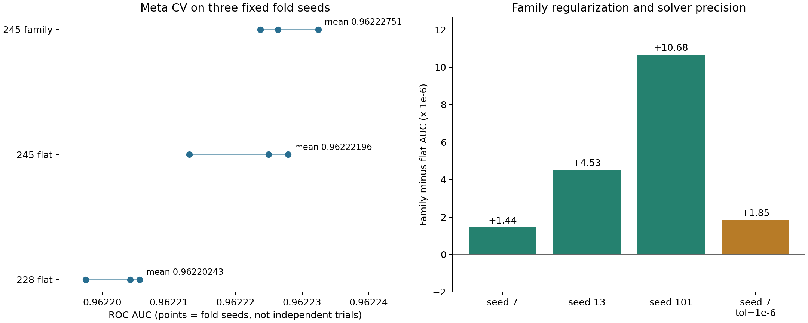

> 历史研究文档，保留原实验范围和当时结果。独立仓库仅包含方法 3 的代码；历史版本代码、CSV 与提交说明不随仓库提供。当前使用方式见 [README](../README.md)。

# 第三轮实验：245 成员与家族正则

第二轮真实成绩已经登记：1、3、4 = **0.96183**，2 = **0.96180**。其方法、训练入口、保存模型和哈希见 `提交历史`。2026-10-13 用户回传：第三轮 1、2、4 为 **0.96187**，3、5 为 **0.96186**。工作报告选择第 3 个家族正则方案，见 [最终方法工作报告](FINAL_METHOD_REPORT.md)。

## 方法与结果

在原有 228 列后添加 kagankoral 17 列公开 OOF，保留全部旧成员及其变换。245 列按原文名称规则分成 GBDT 157、MLP 58、TabPFN 16、TFM/TabM 14；TabPFN 输入乘 3，TFM/TabM 乘 1.5，其余乘 1。固定 C=.003，相当于前两组原始系数的 L2 惩罚分别变成 1/9、1/2.25。该名称分组用于复现正则方案，不是严格的模型分类。

| 元验证 seed | 228 flat | 245 flat | 245 family | 新 17 列增益 | family 增益 |
|---|---|---|---|---|---|
| 7 | 0.96220560 | 0.96222494 | 0.96222639 | +0.00001934 | +0.00000144 |
| 13 | 0.96220418 | 0.96222790 | 0.96223243 | +0.00002372 | +0.00000453 |
| 101 | 0.96219750 | 0.96221303 | 0.96222371 | +0.00001553 | +0.00001068 |

| 对比 | AUC 差 | 改善折数 | 条件配对 95% 区间 |
|---|---|---|---|
| flat245_seed7 − flat228_seed7 | +0.00001934 | 5/5 | [+0.00000634, +0.00003234] |
| flat245_seed13 − flat228_seed13 | +0.00002372 | 5/5 | [+0.00001067, +0.00003678] |
| flat245_seed101 − flat228_seed101 | +0.00001553 | 5/5 | [+0.00000238, +0.00002867] |
| family245_seed7 − flat245_seed7 | +0.00000144 | 4/5 | [-0.00000732, +0.00001021] |
| family245_seed13 − flat245_seed13 | +0.00000453 | 2/5 | [-0.00000442, +0.00001348] |
| family245_seed101 − flat245_seed101 | +0.00001068 | 5/5 | [+0.00000169, +0.00001967] |
| family245_seed7_tol1e6 − flat245_seed7_tol1e6 | +0.00000185 | 3/5 | [-0.00000451, +0.00000822] |

区间只反映固定预测下的按行抽样差异，不包括重训、反复开发或方案选择的不确定性。三种划分来自同一数据，不能作为三个独立实验合并显著性。

## 求解精度与选择

默认 tol=1e-4；seed7 追加 tol=1e-6 时，flat AUC 0.96222413，family AUC 0.96222599，差 +0.00000185。三种默认精度划分的 family 增益全部为正，且较严精度同向，这项选择检查通过。本地首选为 `submission_v3_family.csv`。家族正则的部分条件配对区间跨 0，其改善证据弱于新增 17 列；实际提交中两者均为 0.96186；本地选型依据是验证方向与方法结构，公开榜没有区分两者。



## 提交与来源

| 顺序 | 文件 | 方法 | 本地 seed7 元 CV AUC | 用户实测公开榜 AUC |
|---|---|---|---|---|
| 1 | `submission_v3_twin_published.csv` | 原文两个固定公开父文件，等权排名 | 不填：测试排名融合 | **0.96187** |
| 2 | `submission_v3_twin_family.csv` | 本地家族 L2 + Dariush 247，等权排名 | 不填：测试排名融合 | **0.96187** |
| 3 | `submission_v3_family.csv` | 本地重拟合 245 成员，家族 L2 | 0.96222639 | **0.96186** |
| 4 | `submission_v3_twin.csv` | 本地统一 L2 + Dariush 247，等权排名 | 不填：测试排名融合 | **0.96187** |
| 5 | `submission_v3_245.csv` | 本地重拟合 245 成员，统一 L2 | 0.96222494 | **0.96186** |

固定公开父文件融合与作者最终 CSV 的数值最大差为 0，预测排名完全相同；文件 SHA-256 一致：是。内存计算值到 CSV 的最大舍入差为 1.11e-16。该文件以两份公开预测各占 1/2，本项目完成获取、对齐、重建与验证；两个父模型是已发布的公开产物。

[Twin Stacks 原文，版本 8](https://www.kaggle.com/code/goodpjw2008/s6e10-twin-stacks-family-reg-lb-0-96187)报告 245 pure 和 family-reg 均为 0.96186，固定双 stack 排名平均为 0.96187。后者的一半来自 [Dariush Afshar 的 247-member stack](https://www.kaggle.com/code/dariushafshar/s6e10-247-public-oofs-one-stack-lb-0-96187)。作者报告值来自文章，本项目实测值来自用户反馈，并按文件哈希登记。

新增 17 列来自 [kagankoral 的 ablation-members](https://www.kaggle.com/datasets/kagankoral/s6e10-ablation-members-oof)，固定 version 1，许可元数据 CC BY-SA 4.0；固定 245 父文件来自 [goodpjw2008 extra-members](https://www.kaggle.com/datasets/goodpjw2008/s6e10-goodpjw2008-extra-members-oof) version 2。全部新增下载的来源、版本/session、文件大小和 SHA-256 在 `data/public_v3/manifest.json`，原 228 列仍使用上一轮固定快照。

新增 NPY 无内嵌 id，采用作者声明行序；已核对每列长度、有限性、概率范围和公开 OOF AUC。有 id 的 CSV 按当前 test.id 重排并检查唯一性与集合相等。

## 实验边界与代码

这轮拟合的是公开基预测的组合器，未重训 245 个基模型。元 CV 不能去掉不同基模型划分、早停和历史开发选择的依赖，不能称为完整嵌套验证。测试排名平均没有可直接匹配的独立 CV，不人为给出验证分数。作者对近似 stack 的噪声判断是经验解释；AUC 上不存在平均一定不能超过两个父模型的通用定理。

训练作业 41390，4 CPU、20 GB、无 GPU，用时 26.30 分钟；本次报告与归档作业 41407。同一求解器、C、折数、随机种子、线程和容差用于对应对照；228/seed7 复用第二轮同执行设置对照。新增成员、家族分组、原始空间系数、逐折结果、条件配对差异和预测相关性保存在 `artifacts_v3/`。

- `stack_v3.py`：固定输入、245 列组装、CV、家族正则、全量拟合与排名融合。
- `download_public_v3.py`：新增公开文件的版本固定与校验。
- `finish_v3.py`：重新验证文件与父文件，记录结果、出图和打包。
- `run_v3.sh`：Compute Node 执行入口；`submission_registry.json` 绑定代码、模型、提交哈希与真实回传分数。

```bash
.venv/bin/python -u download_public_v3.py
sbatch run_v3.sh
# 训练成功后：
sbatch --cpus-per-task=2 --mem=6G --time=00:15:00 run_v3.sh finish
```

完整输入准备文件和依赖沿用当前项目；只要源码与输入协议一致，中断后的已完成 CV 会复用。公开榜比较用于验证这些候选，私有榜排名仍待比赛评估。
