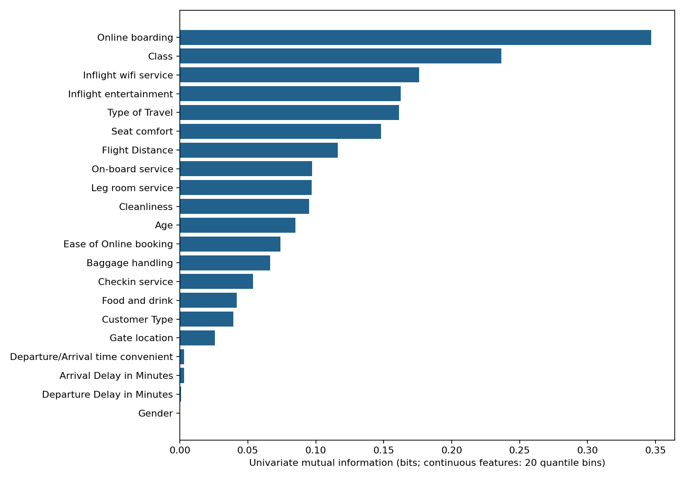
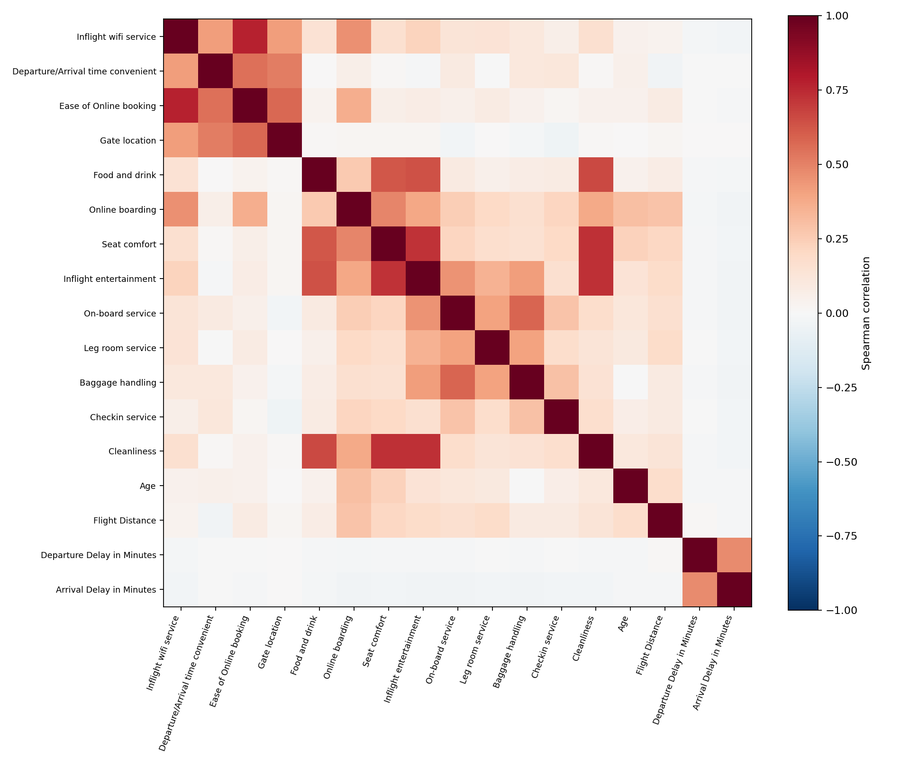
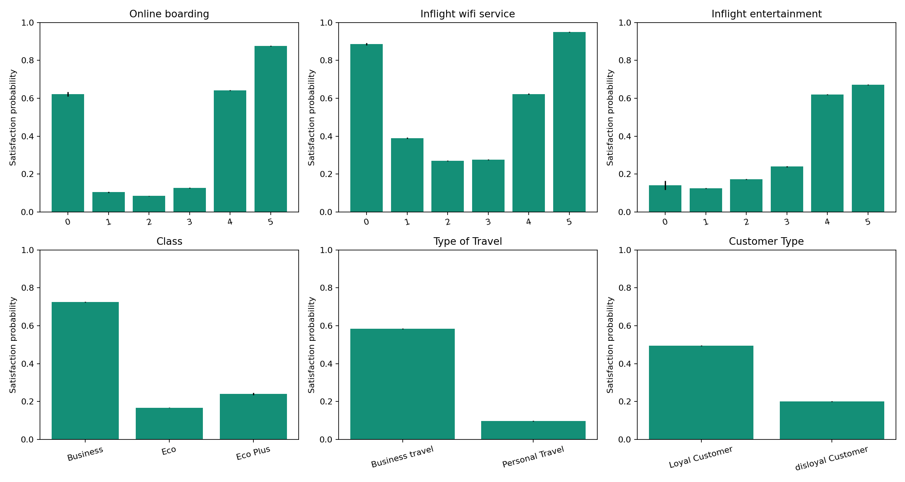
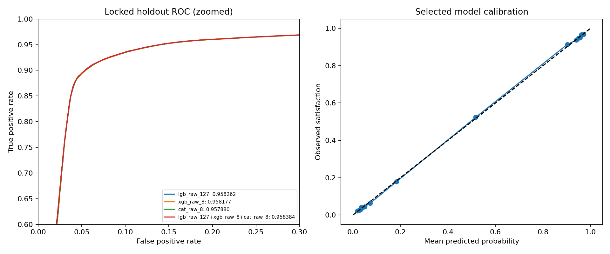
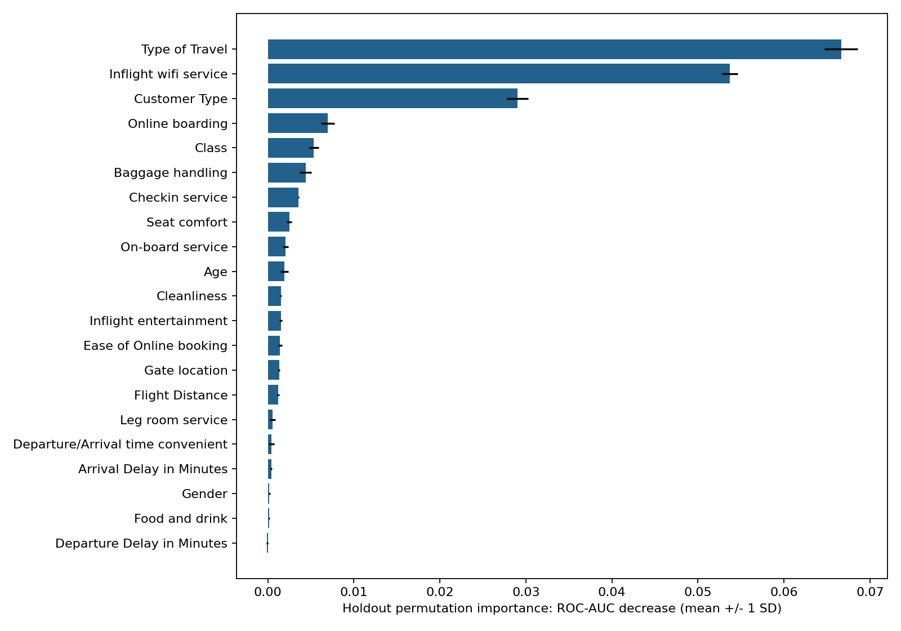

> 历史研究文档，保留原实验范围和当时结果。独立仓库仅包含方法 3 的代码；历史版本代码、CSV 与提交说明不随仓库提供。当前使用方式见 [README](../README.md)。

# Predicting Airline Satisfaction：数据分析与实验结果

实验日期：2026-10-11。完整流程与调研依据见 [PLAN.md](PLAN.md)，评分非单调性、舱位与出行目的交互的定量解读见 [DATA_FINDINGS.md](DATA_FINDINGS.md)。本报告由实际产物生成，所有模型计算运行于 Slurm 作业 41076。

## 最终选择

开发集三折比较选定 **lgb_raw_127+xgb_raw_8+cat_raw_8**，组合权重为 `{"lgb_raw_127": 0.3333333333333333, "xgb_raw_8": 0.3333333333333333, "cat_raw_8": 0.3333333333333333}`。开发 OOF AUC **0.958713**，冻结方案的独立留出 AUC **0.958384**，DeLong 近似 95% 区间 **[0.957255, 0.959513]**；Log loss **0.228312**，0.5 阈值准确率 **0.925904**。AUC 是排名能力，阈值准确率仅作描述。

最终提交使用全部标注数据的五折模型平均；每个模型使用其开发 CV 最优迭代数中位数 `{"lgb_raw_127": 178, "xgb_raw_8": 434, "cat_raw_8": 1034}`，不再根据测试数据或留出分数调参。生成 `submission.csv`，共 **299,844** 行。尚未向 Kaggle 提交，线上分数未知。“最优”指本次明确列出的模型与搜索范围内，按预先设定验证协议选择的结果。

## 数据概况

- 训练 **699,635** 行，测试 **299,844** 行；21 个预测字段：13 个 0–5 服务评分、4 个连续数值、4 个类别字段。id 不进入模型。
- 满意 **310,339** 条，占 **44.3573%**。采用原始类别分布，不做过采样或类别加权。
- 到达延误缺失：训练 **292** 条（0.0417%）、测试 **130** 条（0.0434%）；其他字段完整。树模型原生处理 NaN，逻辑回归在训练分区内中位数编码并添加缺失标志。全部原始记录保留。
- 重复特征组 **0** 组、额外重复行 **0** 条，其中标签冲突 **0** 组；测试中与训练特征完全匹配 **0** 行。相同特征组的记录不跨训练/验证边界。
- 固定划分：`{"fit": 447766, "holdout": 139927, "tune": 111942}`。所有目标关联分析仅使用开发数据，冻结留出标签不参与特征设计、调参、早停或融合选择。

## 特征关联

连续值分成最多 20 个分位区间后计算互信息，离散字段直接计算。互信息反映单变量非线性关联；不同分箱和基数下不可将微小差别视为显著排序。类别字段的 Spearman 列显示“—”，表示不适用。

| feature | mi_bits | cramers_v | spearman_target |
| --- | --- | --- | --- |
| Online boarding | 0.346859 | 0.654831 | 0.602846 |
| Class | 0.236736 | 0.555947 | — |
| Inflight wifi service | 0.176066 | 0.469777 | 0.287220 |
| Inflight entertainment | 0.162538 | 0.460090 | 0.433337 |
| Type of Travel | 0.161360 | 0.444332 | — |
| Seat comfort | 0.148054 | 0.439529 | 0.413362 |
| Flight Distance | 0.116219 | 0.395902 | 0.337024 |
| On-board service | 0.097365 | 0.359866 | 0.353800 |
| Leg room service | 0.096934 | 0.360239 | 0.332159 |
| Cleanliness | 0.095235 | 0.350709 | 0.334901 |
| Age | 0.085073 | 0.334568 | 0.214841 |
| Ease of Online booking | 0.073948 | 0.316908 | 0.191921 |

相关程度最高的数值字段对如下。相关特征可以有不同条件效应；不按相关阈值机械删列。

| a | b | spearman |
| --- | --- | --- |
| Inflight wifi service | Ease of Online booking | 0.770525 |
| Seat comfort | Cleanliness | 0.733252 |
| Inflight entertainment | Cleanliness | 0.727072 |
| Seat comfort | Inflight entertainment | 0.722780 |
| Food and drink | Cleanliness | 0.658094 |
| Food and drink | Inflight entertainment | 0.633561 |
| Food and drink | Seat comfort | 0.620694 |
| On-board service | Baggage handling | 0.580557 |
| Ease of Online booking | Gate location | 0.577345 |
| Departure/Arrival time convenient | Ease of Online booking | 0.549446 |

客户分组满意率：

| feature | value | count | satisfaction_rate |
| --- | --- | --- | --- |
| Gender | Female | 278267 | 0.438550 |
| Gender | Male | 281441 | 0.448542 |
| Customer Type | Loyal Customer | 461638 | 0.495208 |
| Customer Type | disloyal Customer | 98070 | 0.200520 |
| Type of Travel | Business travel | 397923 | 0.584329 |
| Type of Travel | Personal Travel | 161785 | 0.097376 |
| Class | Business | 273621 | 0.725606 |
| Class | Eco | 262053 | 0.167703 |
| Class | Eco Plus | 24034 | 0.240659 |

关键评分满意率：

| feature | value | count | satisfaction_rate |
| --- | --- | --- | --- |
| Inflight wifi service | 0 | 10488 | 0.886728 |
| Inflight wifi service | 1 | 86249 | 0.390555 |
| Inflight wifi service | 2 | 149560 | 0.270086 |
| Inflight wifi service | 3 | 147411 | 0.276608 |
| Inflight wifi service | 4 | 102585 | 0.622333 |
| Inflight wifi service | 5 | 63415 | 0.950501 |
| Online boarding | 0 | 7316 | 0.622061 |
| Online boarding | 1 | 46172 | 0.104695 |
| Online boarding | 2 | 95339 | 0.084908 |
| Online boarding | 3 | 119946 | 0.128158 |
| Online boarding | 4 | 168639 | 0.642301 |
| Online boarding | 5 | 122296 | 0.875769 |
| Inflight entertainment | 0 | 820 | 0.141463 |
| Inflight entertainment | 1 | 56046 | 0.125451 |
| Inflight entertainment | 2 | 90966 | 0.173010 |
| Inflight entertainment | 3 | 98255 | 0.239672 |
| Inflight entertainment | 4 | 168230 | 0.619681 |
| Inflight entertainment | 5 | 145391 | 0.671218 |

评分的 0 单独保留。上述是调查中的条件关联，不能据此推断改变某项服务会造成同等幅度的满意度变化。舱位、出行目的、忠诚度与服务评分共同建模。

训练/测试分布差异最大的字段：

| feature | statistic | distance |
| --- | --- | --- |
| Cleanliness | total_variation | 0.002914 |
| Food and drink | total_variation | 0.002364 |
| On-board service | total_variation | 0.002349 |
| Leg room service | total_variation | 0.002049 |
| Departure/Arrival time convenient | total_variation | 0.001914 |
| Baggage handling | total_variation | 0.001693 |
| Gender | total_variation | 0.001536 |
| Seat comfort | total_variation | 0.001517 |

连续字段 KS 与离散字段总变差都是分布距离，定义不同；此处展示数值用于诊断，不以大样本 p 值决定是否删字段。延误 KS 使用已观测值，缺失比例单独统计。

## 特征工程消融

以下 LightGBM 均使用 31 叶及相同调参分区，分别加入一组特征。完整构造公式见 `features.py` 与 [PLAN.md](PLAN.md)。

| name | n_features | rounds | auc | delta_auc_vs_raw | log_loss |
| --- | --- | --- | --- | --- | --- |
| lgb_raw_31 | 21 | 581 | 0.958152 | 0.000000 | 0.227993 |
| lgb_delay_31 | 34 | 817 | 0.958085 | -0.000067 | 0.228089 |
| lgb_service_31 | 57 | 618 | 0.958044 | -0.000109 | 0.227996 |
| lgb_interactions_31 | 31 | 422 | 0.957906 | -0.000246 | 0.228242 |
| lgb_all_31 | 80 | 340 | 0.957697 | -0.000456 | 0.228291 |

只保留验证支持的配置，特征数量增加本身不代表改进。服务分数汇总可能与原始评分冗余；类别交互可帮助有限深度树表达分组阈值；延误 log 变换的排序与原值相同，对树并不天然增加信息。

## 候选模型初筛

| name | n_features | rounds | auc | log_loss | fit_seconds |
| --- | --- | --- | --- | --- | --- |
| lgb_raw_127 | 21 | 187 | 0.958578 | 0.226792 | 10.320311 |
| lgb_raw_63 | 21 | 193 | 0.958378 | 0.227555 | 9.511898 |
| xgb_raw_8 | 21 | 348 | 0.958323 | 0.228036 | 3.463968 |
| lgb_raw_31 | 21 | 581 | 0.958152 | 0.227993 | 16.565318 |
| xgb_raw_6 | 21 | 835 | 0.958145 | 0.228456 | 6.602394 |
| xgb_all_6 | 80 | 410 | 0.958107 | 0.228129 | 10.654409 |
| lgb_delay_31 | 34 | 817 | 0.958085 | 0.228089 | 22.115724 |
| cat_raw_8 | 21 | 737 | 0.958071 | 0.228476 | 22.786293 |
| lgb_service_31 | 57 | 618 | 0.958044 | 0.227996 | 24.436086 |
| lgb_ratings_categorical | 21 | 264 | 0.958008 | 0.228731 | 10.640821 |
| cat_all_7 | 80 | 776 | 0.957972 | 0.228007 | 40.759065 |
| cat_raw_7 | 21 | 1073 | 0.957947 | 0.228545 | 26.470096 |
| lgb_interactions_31 | 31 | 422 | 0.957906 | 0.228242 | 18.849817 |
| lgb_all_31 | 80 | 340 | 0.957697 | 0.228291 | 23.905509 |
| logistic_raw | 21 | 40 | 0.948730 | 0.272201 | 3.173617 |

初筛在固定 tune 分区比较，并用于 early stopping；重复比较会使这些分数偏乐观，不能用它直接宣称泛化表现。学习率固定 0.05，最大 2000 轮、早停耐心 120；LightGBM 比较 31/63/127 叶、评分类别化与分组特征，XGBoost 比较深度 6/8，CatBoost 比较深度 7/8。具体参数完整保存于 `artifacts/screen_specs.json`。GPU CatBoost 的浮点归约可能使同种子重训产生微小差异。

## 三折交叉验证与选择

各树家族的初筛优胜者在同一开发三折上比较。OOF 为每行未参与该折拟合的预测，折验证仍用于早停；配置选择也使用开发标签，因此这里是开发证据。

| name | models | auc | fold_auc_mean | fold_auc_std | log_loss |
| --- | --- | --- | --- | --- | --- |
| lgb_raw_127+xgb_raw_8+cat_raw_8 | 3 | 0.958713 | 0.958718 | 0.000224 | 0.227000 |
| lgb_raw_127+xgb_raw_8 | 2 | 0.958706 | 0.958711 | 0.000222 | 0.227116 |
| lgb_raw_127+cat_raw_8 | 2 | 0.958624 | 0.958629 | 0.000233 | 0.226999 |
| lgb_raw_127 | 1 | 0.958559 | 0.958566 | 0.000224 | 0.227331 |
| xgb_raw_8+cat_raw_8 | 2 | 0.958556 | 0.958562 | 0.000238 | 0.227553 |
| xgb_raw_8 | 1 | 0.958458 | 0.958463 | 0.000236 | 0.227968 |
| cat_raw_8 | 1 | 0.958165 | 0.958173 | 0.000269 | 0.228373 |

融合候选仅为三个家族优胜者的两两等权及三者等权平均。只有平均 AUC 比最佳单模型高至少 0.0001，且至少 2/3 折提高，才采用融合；否则保留单模型。独立留出前将选择与迭代数写入 `selection.json`。

开发比较中最高三模型与最高两模型 OOF AUC 的差为 +0.000007，两模型方案具有接近的开发成绩和较低推理成本。

## 独立留出与误差边界

| name | auc | ci95_low | ci95_high | log_loss | brier | accuracy_at_0.5 |
| --- | --- | --- | --- | --- | --- | --- |
| lgb_raw_127 | 0.958262 | 0.957132 | 0.959392 | 0.228762 | 0.061187 | 0.925726 |
| xgb_raw_8 | 0.958177 | 0.957044 | 0.959310 | 0.229177 | 0.061276 | 0.925504 |
| cat_raw_8 | 0.957880 | 0.956739 | 0.959021 | 0.229407 | 0.061236 | 0.925490 |
| lgb_raw_127+xgb_raw_8+cat_raw_8 | 0.958384 | 0.957255 | 0.959513 | 0.228312 | 0.061010 | 0.925904 |

融合相对最佳单模型的留出 AUC 差为 **+0.000123**，配对 95% 区间 **[-0.000057, +0.000302]**。区间跨 0，本次留出样本不足以确认融合优于该单模型；融合选择来自预先完成的开发集比较。

留出 **139,927** 行，所有模型使用完整开发集、固定迭代数重训后一次评估。此表用于评估冻结候选，不据其排序改变选择。候选之间的配对 AUC 差及区间见 `artifacts/holdout_differences.json`。区间按行独立近似计算，未包含重训随机性、调参选择的不确定性或潜在数据分布变化；重复组统计见上文。最终五折集成使用了更多标签，其测试性能仍需要 Kaggle 检验。

留出集上的分组误差：

| feature | value | rows | positive_rate | auc | log_loss | accuracy_at_0.5 |
| --- | --- | --- | --- | --- | --- | --- |
| Class | Eco | 65351 | 0.166975 | 0.901571 | 0.232203 | 0.920399 |
| Class | Business | 68591 | 0.724133 | 0.933968 | 0.222520 | 0.932396 |
| Class | Eco Plus | 5985 | 0.248287 | 0.927599 | 0.252204 | 0.911612 |
| Type of Travel | Personal Travel | 40409 | 0.096810 | 0.823523 | 0.213627 | 0.932960 |
| Type of Travel | Business travel | 99518 | 0.584367 | 0.954045 | 0.234275 | 0.923039 |
| Customer Type | Loyal Customer | 115352 | 0.494894 | 0.957957 | 0.227584 | 0.928662 |
| Customer Type | disloyal Customer | 24575 | 0.202645 | 0.926518 | 0.231729 | 0.912960 |
| Gender | Female | 69685 | 0.435775 | 0.958788 | 0.226781 | 0.926024 |
| Gender | Male | 70242 | 0.451297 | 0.957953 | 0.229830 | 0.925785 |

## 模型重要性

对 **12,000** 条按标签分层抽取的留出样本重复置换 3 次。每次从原始字段开始置换，再重新构造全部派生特征。单变量前五项为：**Type of Travel, Inflight wifi service, Customer Type, Online boarding, Class**。报告 AUC 降幅均值及重复间标准差；标准差不是总体置信区间。负值表示该样本上没有稳定的正向贡献。

置换排序与单变量互信息排序不同：互信息衡量单个字段包含的标签信息，置换衡量模型在已有其他字段条件下对该字段的依赖。在线登机、舱位与其他体验评分共享信号；出行目的、Wi-Fi、客户忠诚度还决定分组阈值，需结合模型交互理解。

| feature | auc_drop_mean | auc_drop_std |
| --- | --- | --- |
| GROUP: traveler | 0.149665 | 0.002127 |
| GROUP: digital | 0.125306 | 0.002913 |
| Type of Travel | 0.066656 | 0.001938 |
| Inflight wifi service | 0.053718 | 0.000930 |
| Customer Type | 0.029022 | 0.001230 |
| GROUP: comfort | 0.008576 | 0.000361 |
| Online boarding | 0.006970 | 0.000799 |
| Class | 0.005306 | 0.000583 |
| Baggage handling | 0.004386 | 0.000679 |
| Checkin service | 0.003572 | 0.000076 |
| Seat comfort | 0.002496 | 0.000291 |
| On-board service | 0.002056 | 0.000312 |
| Age | 0.001895 | 0.000462 |
| Cleanliness | 0.001530 | 0.000055 |
| Inflight entertainment | 0.001516 | 0.000172 |
| Ease of Online booking | 0.001406 | 0.000225 |
| Gate location | 0.001319 | 0.000107 |
| Flight Distance | 0.001219 | 0.000121 |
| Leg room service | 0.000560 | 0.000316 |
| Departure/Arrival time convenient | 0.000412 | 0.000307 |
| Arrival Delay in Minutes | 0.000395 | 0.000083 |
| GROUP: delays | 0.000321 | 0.000100 |
| Gender | 0.000165 | 0.000105 |
| Food and drink | 0.000156 | 0.000078 |
| Departure Delay in Minutes | -0.000091 | 0.000100 |

强相关字段的单独置换可能低估整组信号，故增加延误、数字服务、舒适度、旅客属性的联合置换。联合组与单字段的降幅不可相加；置换还可能产生少见特征组合，重要性描述模型依赖而非因果效应。

## 交付与复现

- 环境：Python 3.9.19；版本 `{"numpy": "2.0.2", "pandas": "2.3.3", "scikit-learn": "1.6.1", "lightgbm": "4.6.0", "xgboost": "2.1.4", "catboost": "1.2.10"}`；GPU `NVIDIA A40, 46068 MiB, 570.148.08`；6 CPU、24 GB、1 GPU。正式训练作业耗时 11.57 分钟。
- 最终五折 OOF AUC：0.958890。全局配置已经用过部分相同行的标签，此值仅描述最终训练产物，不替代独立留出成绩。
- 提交概率范围 [0.00504159, 0.99015741]，均值 0.44369927。
- 保存预测重建提交的最大绝对误差 5.55e-16；id 顺序、行数、有限性及 [0,1] 概率范围均验证。
- 提交 SHA256：`a36bd219415477f500e19cc01dc5b9bd851a43ec1391855e09ea87a5e8b8ec7c`。数据及源码指纹、环境、划分、模型、OOF、每折测试概率均在 `artifacts/`。
- 运行命令见 [README.md](../README.md)；`sbatch run.sh predict` 可从五折模型重新生成提交并核对误差。

后续如增加模型或目标编码，应新设外层验证或保留未使用数据，避免把已公开的留出成绩继续用作调参依据。此次未使用外部原始调查标签，也未通过测试 id 查找标签。
